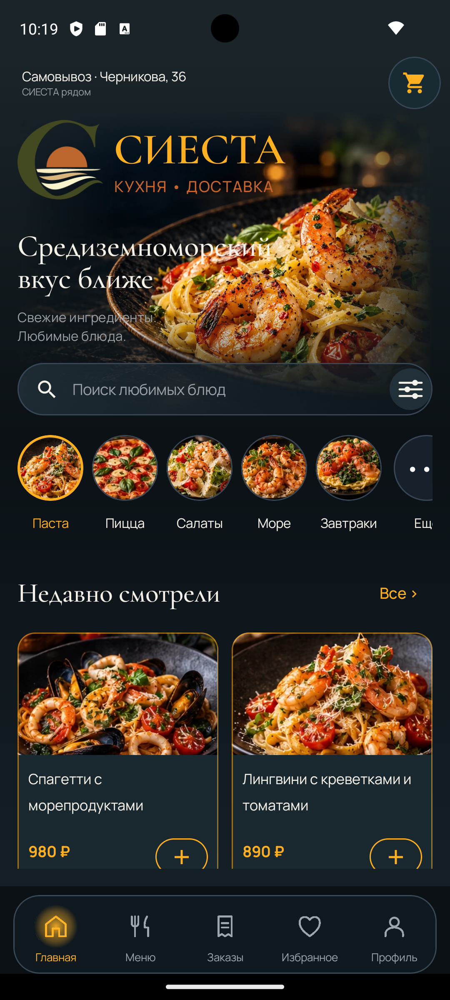
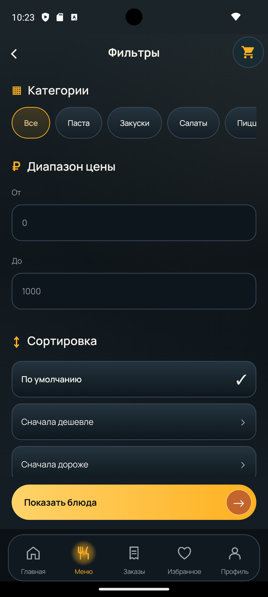
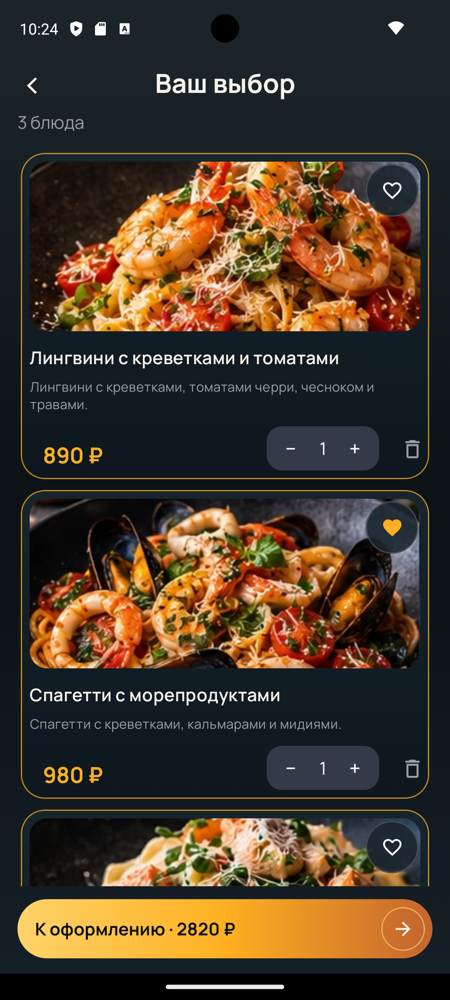
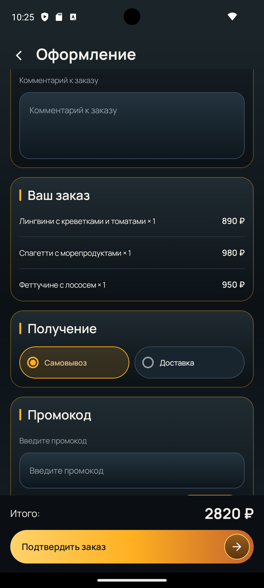
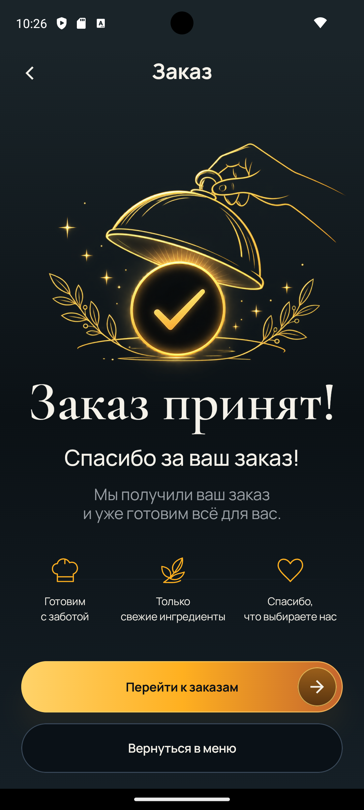
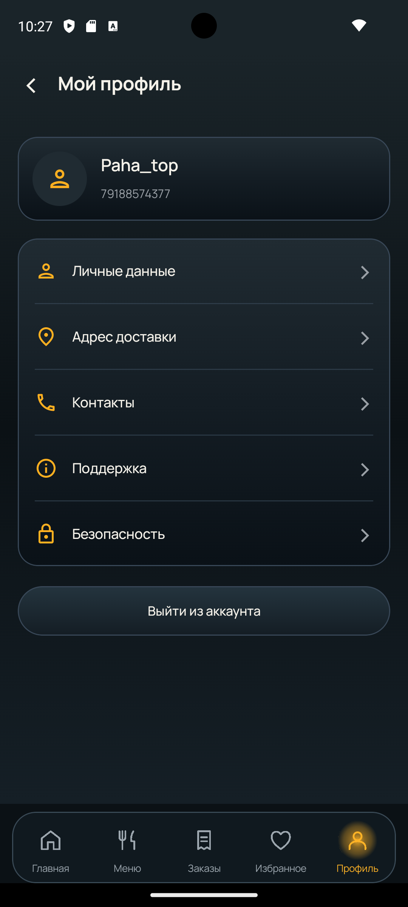

# СИЕСТА / FoodHub — Android

**Клиент-серверное приложение для заказа еды.** Собственный проект Павла Колпакова, активно развивается и тестируется; не заявляется как опубликованный релиз.

**[Backend (Kotlin / Ktor / PostgreSQL)](https://github.com/pavel7773/CateringBackend)**

## Возможности

Каталог блюд, категории, поиск, фильтры и сортировка, избранное, недавно просмотренные блюда, корзина, оформление заказа с промокодом, история и повтор заказа, профиль и авторизация.

## Стек

| Область | Технологии |
| --- | --- |
| Android UI | Kotlin, Jetpack Compose, Navigation Compose, Material 3 |
| Состояние и асинхронность | ViewModel, Coroutines, Flow, StateFlow |
| Архитектура и DI | MVVM, слои presentation / domain / data, Hilt |
| Сеть | Retrofit, REST API |
| Локальные данные | Room, DataStore |
| Тесты | JUnit, MockK, Coroutines Test, Android instrumented tests |

## Архитектура

- `ui/screens` — переиспользуемые экраны Jetpack Compose, UI-состояния и callbacks.
- `ui/routes` / `navigation` — привязка ViewModel и навигационные переходы.
- `presentation` — ViewModel и управление состояниями интерфейса.
- `domain` — модели, контракты репозиториев и use cases.
- `data` — Retrofit API, Room/DataStore и реализации репозиториев.
- `di/hilt` — предоставление зависимостей.

Сетевой backend разрабатывается отдельно на **Kotlin/Ktor** с **PostgreSQL**, **Exposed** и **Flyway**. Он не является частью Android APK.

## Инженерные решения

**Кэширование меню.** При успешной загрузке с сервера меню сохраняется в Room. Если сеть недоступна, репозиторий использует существующий кэш; отмена корутины не подменяется ошибкой сети.

**Идемпотентность заказов.** Для попытки создания заказа формируются отпечаток содержимого и ключ идемпотентности. Ключ сохраняется через DataStore и повторно используется при соответствующем retry. Сервер дополнительно защищает запись заказа уникальным ограничением в PostgreSQL.

**Управление UI.** ViewModel и StateFlow обеспечивают различимые состояния загрузки, успешного результата и ошибки; фильтры и сортировка работают поверх состояния меню.

## Демонстрация приложения

<p align="center">
  
  
  
</p>
<p align="center">
  
  
  
</p>
<p align="center">
  
</p>

## Тестирование

В репозитории есть локальные unit-тесты ViewModel, use cases и репозиториев, а также инструментальные проверки Room, в том числе миграций БД.

Среди проверяемых сценариев: загрузка и кэширование меню, поиск и фильтры, восстановление и отзыв сессии, расчёт корзины, промокоды, создание заказа и повторное использование ключа идемпотентности.

**Пример проверки:** `MenuViewModelTest` содержит девять сценариев, включая ошибки, поиск, отмену и предотвращение одновременных refresh-запросов. Наличие других тестовых файлов не означает, что каждый тестовый набор был запущен при подготовке этого README.

## Запуск

1. Установите Android Studio с JDK и Android SDK, совместимыми с версиями Gradle/AGP в репозитории.
2. Откройте корневую папку `FoodHub` и дождитесь Gradle Sync.
3. Запустите конфигурацию `app` на Android-эмуляторе или устройстве с Android 8.0 (API 26) и выше.
4. Для сценариев с сетью необходим доступ к backend. Адрес API задан в `app/src/main/java/com/example/catering/di/hilt/NetworkModule.kt`; перед запуском убедитесь, что он указывает на доступный сервер.

Примеры Gradle-команд из корня репозитория (Windows: `gradlew.bat` вместо `./gradlew`):

```bash
./gradlew :app:assembleDebug
./gradlew :app:testDebugUnitTest
```

Инструментальные тесты из `app/src/androidTest` требуют запущенного эмулятора или устройства.

## Статус и автор

**Статус:** активная разработка; выпуск и дополнительные проверки качества ещё в процессе.

**Павел Колпаков** — Android / Kotlin-разработка, взаимодействие с backend и автоматизированное тестирование.

[Исходный код backend](https://github.com/pavel7773/CateringBackend)
